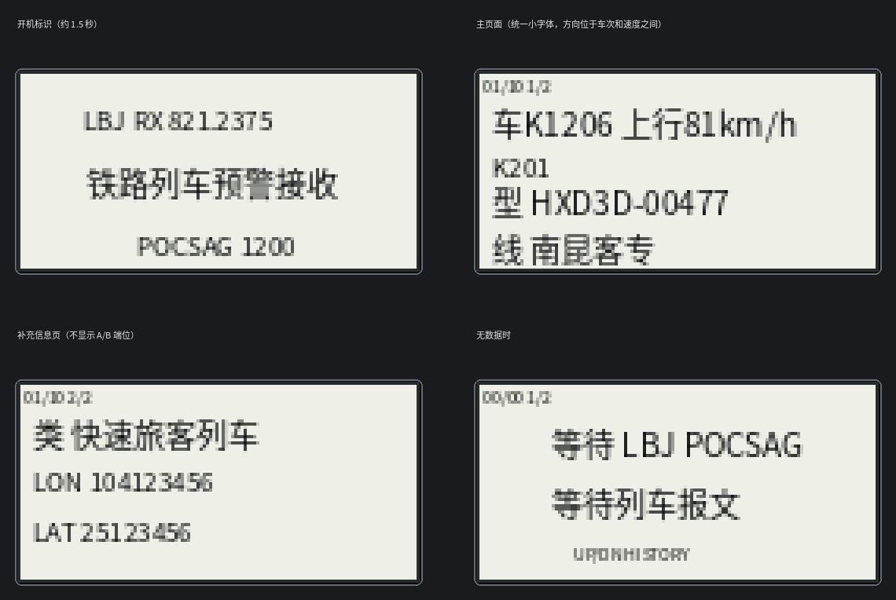

> **长期交接入口：** 新会话请先阅读 [docs/CONTINUATION.md](docs/CONTINUATION.md)，以 GitHub `main` 分支为准继续开发。该文档记录仓库文件、验证边界、缺失的完整 LOSEHU 基础源码和下一步构建顺序。
> **上游源码基线：** 作者 [losehu/uv-k5-firmware-custom](https://github.com/losehu/uv-k5-firmware-custom) 的 `0.13.2` 标签（commit `021656ea13226d349e31acd6eb21079c5bab64c7`）；版本对应分析见 [docs/UPSTREAM_BASE.md](docs/UPSTREAM_BASE.md)。
> **完整固件构建：** GitHub Actions 的 [Build K6 LBJ RX](.github/workflows/build-lbj.yml) 从固定上游源码拉取、安装 overlay 并构建，结果保存在 Actions artifacts。

# K6 LBJ 独立接收固件 v0.2（UI rev3 + BK4819 FSK 适配）

目标设备：老款泉盛 K6，DP32G030 + BK4819。底座按 `losehu/uv-k5-firmware-custom` 的老款 K5/K6 源码接口编写。

**这版已经加入 BK4819 直 FSK 1200 配置、FIFO 中断读取，以及到 POCSAG 位流解码器的连接；但它仍是“待射频实测的集成候选版”，不是已验证可刷写固件。** 主机测试和 Cortex-M0 overlay 对象编译通过；当前环境没有完整 LOSEHU 本地源树和 `arm-none-eabi-gcc`，因此没有完成 LOSEHU 全工程链接，也没有生成最终 `firmware.bin`。

## 屏幕布局



图为 128×64 屏幕排版示意，不是实机截图。

| 页面 | 显示内容 |
|---|---|
| 开机标识 | `LBJ RX 821.2375`，约 1.5 秒后自动进入主页面；频率不再常驻显示 |
| 主页面第一行 | `车` + 车次 + `上行/下行/待定` + 速度；方向直接夹在车次和速度之间，不加“方向”前缀，速度不加“速度”前缀 |
| 主页面第二行 | 公里标以普通小字体独立显示，例如 `K201`；只显示整数公里，原始小数值仍留在内部用于方向判断 |
| 主页面底部 | `型` + 机车型号/车号；`线` + 线路，型号和线路靠下排列 |
| 补充信息页 | 新规则车次类型、经纬度原始数字；不显示 A/B 端位 |
| 无数据 | 等待 LBJ POCSAG 报文 |

主页面所有信息统一使用上一版的常规小字体，不再把公里标放大；只有屏幕最上方的历史序号/页码状态提示继续使用原本的微型状态字体。公里标、车次、速度、型号和线路保持一致的字号与字形风格。

### 按键安排

| 按键 | 操作 |
|---|---|
| UP | 查看较新的历史记录 |
| DOWN | 查看较旧的历史记录 |
| MENU | 在主页面和补充信息页之间切换 |
| EXIT | 退出 LBJ 页面，返回普通电台主页面 |

不额外占用长按功能，也不改变原有多系统引导器按键。

历史记录暂定 **10 条**，仅放 RAM，不向 EEPROM 写入。`LBJ_TrainRecord` 为 152 字节，10 条加 engine 索引/待绑定缓存约 1.8 KiB；这不等于固件 Flash 占用。历史数据断电会清空。

## 当前实现

### 1. POCSAG 1200 解码核心

`FirmwareOverlay/app/lbj_pocsag.c`

- POCSAG 同步字 `0x7CD215D8`。
- 识别正常/反相判决极性；同步字容忍最多 2 bit 差异。
- 处理 16-word batch 的码字流。
- BCH(31,21) + parity 检查；可纠正单 bit 错误。
- 按 Function 0 数字页、Function 1–3 文本页组装载荷。
- 页完成后通过 callback 交给业务层，不在 FIFO/中断路径中做 UI 绘制。
- `LBJ_AppQueueBit(bit, now_ms)` 是 ISR/射频入口；`lbj_radio.c` 从 BK4819 FIFO 取数据，按低字节先、高字节后和 MSB-first 位序送入 128 项环形队列。`APP_Update()` 中的 `LBJ_AppProcess()` 每轮最多处理 64 bit，BCH 和业务解析不放在中断里。

### 2. LBJ 业务解析

`FirmwareOverlay/app/lbj_core.c`

- 解析 `1234000`：车次原始数字、速度、公里标（末位为小数位）、Function 方向提示。
- 解析 `1234002`：两字节 ASCII 前缀、8 位 BCD 机车登记号、端位、8 字节 GB2312 线路名、经纬度数字。
- 车型号取法与 Windows 版 `LBJ_Map/main.py` 一致：CRH 车型取登记号第 4–7 位，其余车型取后 5 位，保留前导零。
- `1234000` 与 `1234002` 以 2.5 秒窗口做最近事件匹配；未先后到达时保留最多 3 条待绑定机车信息。后续同车次运行报文可继承最近一次绑定。
- 每辆车的方向优先按公里标变化判断；公里标不足时使用 Function 3=上行、1=下行提示。

### 3. 车型库

`FirmwareOverlay/app/lbj_loco.c` 共 153 项，按你提供的注册号映射生成，不使用旧 SX1276 工程中的数组索引替代。

### 4. 新版车次规则

`FirmwareOverlay/app/lbj_train_type.c` 按 `New-Train-Number-Compilation-Rules` 的 `mian（动车组自2026年12月下旬）.py` 分类顺序移植。包括 `F` 折返、`00` 动车组回送优先、普通 `0` 回送、DJ 检测/确认、DH、B 班列、X/G/T/K/D 试运行、普速字头和纯数字货运区间；保留规则中的区间空档，不做简单前缀泛化。

## 文件结构

```text
K6_LBJ_RX_Prototype/
  FirmwareOverlay/        # 可拷入 LOSEHU 源码树的 app/ui 文件
    app/                  # POCSAG、LBJ 业务、车型表、车次分类
    ui/                   # LBJ LCD 页面
  src/                    # 同一核心模块的主机测试版本
  include/                # 主机测试头文件
  tests/                  # POCSAG、字段绑定、车次分类和启动页计时测试
  tools/install_overlay.py
  tools/build_arm_overlay_objects.py
  docs/FSK_ADAPTER_DESIGN.md
  docs/lcd_preview.png
```

## 已执行的验证

在本包目录执行：

```sh
make clean test syntax-firmware-overlay
python3 tools/build_arm_overlay_objects.py
```

当前输出：

```text
host tests: PASS
core tests: PASS
app tests: PASS
radio adapter tests: PASS
firmware overlay C syntax: PASS
ARM EABI overlay objects: PASS (7 .o files; Clang 17)
```

测试覆盖：POCSAG 正常/反相极性、文本/数字页、单 bit BCH 错误纠正、`1234000`/`1234002` 绑定、`HXD3D-00477` 车号保留前导零、GB2312 线路字段、重复运行报文继承绑定、公里标变化方向判断、新版车次规则代表区间、两页循环，以及启动标识 1.5 秒计时（含 16 位 tick 回绕）。语法检查使用本包的接口 stub，不是完整 LOSEHU 工程 ARM 链接。

安装脚本已在模拟 LOSEHU 目录完成 dry-run、写入、二次幂等写入和 Makefile 保护条件测试；射频寄存器和 FIFO 由主机 mock 测试覆盖。

## 在 Windows 上准备独立构建副本（不要改日常工程）

先把 LOSEHU 源码完整复制/克隆到单独目录，例如 `D:\work\uv-k5-firmware-custom-LBJ`。不要在日常固件的工作目录直接执行安装脚本；独立目录可以避免 `firmware.bin` 和目标文件覆盖日常版本。

在 PowerShell 中从本包目录执行：

```powershell
python .\tools\install_overlay.py D:\work\uv-k5-firmware-custom-LBJ --dry-run
python .\tools\install_overlay.py D:\work\uv-k5-firmware-custom-LBJ
Set-Location D:\work\uv-k5-firmware-custom-LBJ
make clean
make build ENABLE_LBJ=1 ENABLE_MESSENGER=0 ENABLE_MDC1200=0 ENABLE_AIRCOPY=0
(Get-Item .\firmware.bin).Length
```

`make build` 只构建，不写电台；不要用 `make all` 或 `make flash`。LBJ 模式会关闭 UART（避免串口设置命令写 EEPROM）、VOX、DTMF 呼叫、自定义发送侧键、报警和 1750 Hz 发射，并在 `RADIO_PrepareTX`、`RADIO_PrepareCssTX`、`RADIO_SetTxParameters` 入口增加硬性 TX 返回保护。构建脚本会拒绝同时开启 Messenger、MDC1200 或 Aircopy，因为它们会争用 BK4819 FSK FIFO。`ENABLE_LBJ` 默认是 0，未指定时原固件编译路径保持关闭。

`82123750` 是 LOSEHU 的 10 Hz 频率单位，对应 821.2375 MHz；安装代码将接收指针强制指回 RX 频率结构，只改 RAM，不保存频道或 EEPROM。最终 `firmware.bin` 大小必须低于现有多系统引导器单槽 60 KiB 限制，当前还没有实际链接结果，所以不能假定它能放入槽位。

## 编译状态与剩余验证（当前仍不要刷机）

1. **BK4819 直 FSK 1200 FIFO 适配已接入源码。** `lbj_radio.c` 配置 `REG_58=0x00C1`（直 FSK 1.2K，不是 FFSK 1200/1800），设置 `0x7CD215D8` 同步字，并按 4 个 FIFO words 排空 `REG_5F`；正常/反相极性都会进入软件解码器。
2. 数据字段设置为 2048 字节（`REG_5D=0xFFE0`），在 1200 bit/s 下约为 13.65 秒。首次同步由硬件识别，后续 POCSAG batch sync 留在数据流中交给 MCU 解析。该长接收窗口的跨报文行为、前导码检测和数据字节方向仍需实机/信号源验证。
3. **Cortex-M0 ARM EABI overlay 对象已使用 Clang 17 编译成功**，但这只是 LBJ 的 7 个独立 `.o` 文件，使用本包接口 stub，不等于完整 LOSEHU 链接。
4. 当前执行环境没有 `arm-none-eabi-gcc` / `arm-none-eabi-objcopy`，也没有完整 LOSEHU 本地源码树，因此没有最终 `firmware.bin`、没有测得实际 image 大小；多系统加载器每槽 60 KiB 的限制还未核验。
5. 没有 K6 实机 RF 测试、接收灵敏度测试、屏幕测试或多系统槽位安装测试。必须先验证 POCSAG 同步、位序、正常/反相、完整报文和 2048 字节窗口后的重新捕获。
6. 频率写入值已按 LOSEHU 的 10 Hz 单位修正为 `82123750`（即 821.2375 MHz），并显式把 RX 指针设回 `freq_config_RX`；频率只改运行时 RAM，不保存到频道或 EEPROM。
7. 没有修改引导器、EEPROM 槽位元数据、日常 LOSEHU 固件，也没有写入电台。LBJ 构建会关闭串口写 EEPROM 的入口，但设备原有固件/bootloader 的存储行为仍需另行保持不动。

**当前包是已通过代码/对象级编译的 RF 集成候选版，不是可直接刷入的最终固件。** 完成顺序仍是：在你的 LOSEHU 源树运行安装脚本 → 用完整 ARM 工具链链接 → 核查 `.bin` 不超过 60 KiB → 用信号源/已知录音验证 RF FIFO 和 POCSAG → 再决定是否写入独立槽位。

## 参考源码

- LOSEHU K5/K6 固件底座：<https://github.com/losehu/uv-k5-firmware-custom>
- LOSEHU BK4819 FSK/FSK FIFO 参考：<https://github.com/losehu/uv-k5-firmware-custom/blob/main/driver/bk4819.c>
- BK4819v3 应用说明（FSK 寄存器字段参考）：<https://www.scribd.com/document/829727106/BK4819-Application-Note-v1-0>
- POCSAG RX 算法参考（不同 MCU，不能直接烧录）：<https://github.com/armel/uv-k1-k5v3-firmware-custom/tree/main/App/apps/pocsagrx>
- Windows 版 LBJ 字段和车型解析参考：<https://github.com/rzwcl/LBJ_Map/blob/main.py>
- 新版车次分类规则：<https://github.com/rzwcl/New-Train-Number-Compilation-Rules/blob/main/mian%EF%BC%88%E5%8A%A8%E8%BD%A6%E7%BB%84%E8%87%AA2026%E5%B9%B412%E6%9C%88%E4%B8%8B%E6%97%AC%EF%BC%89.py>
